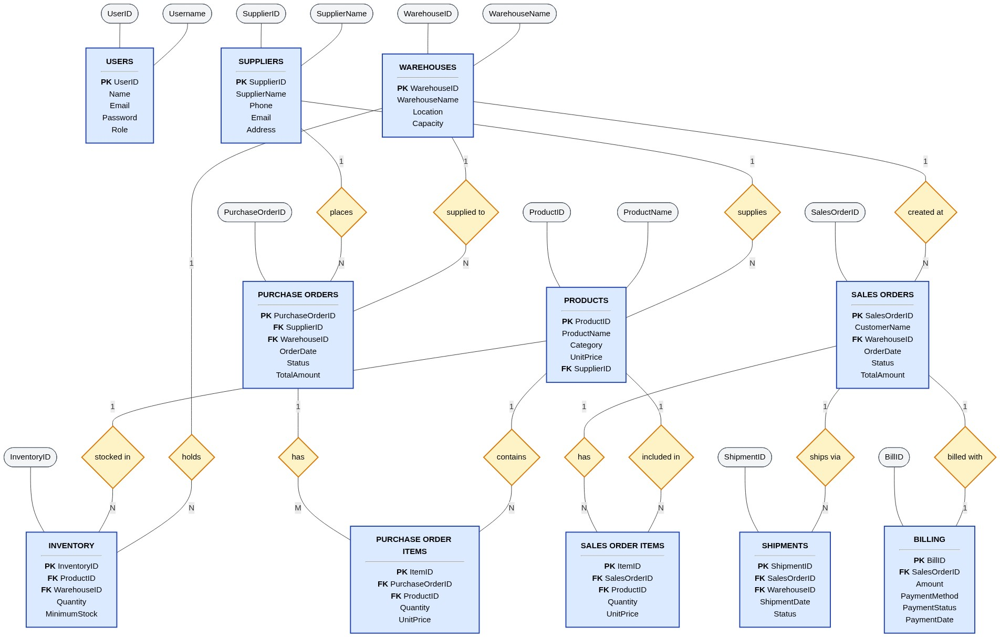
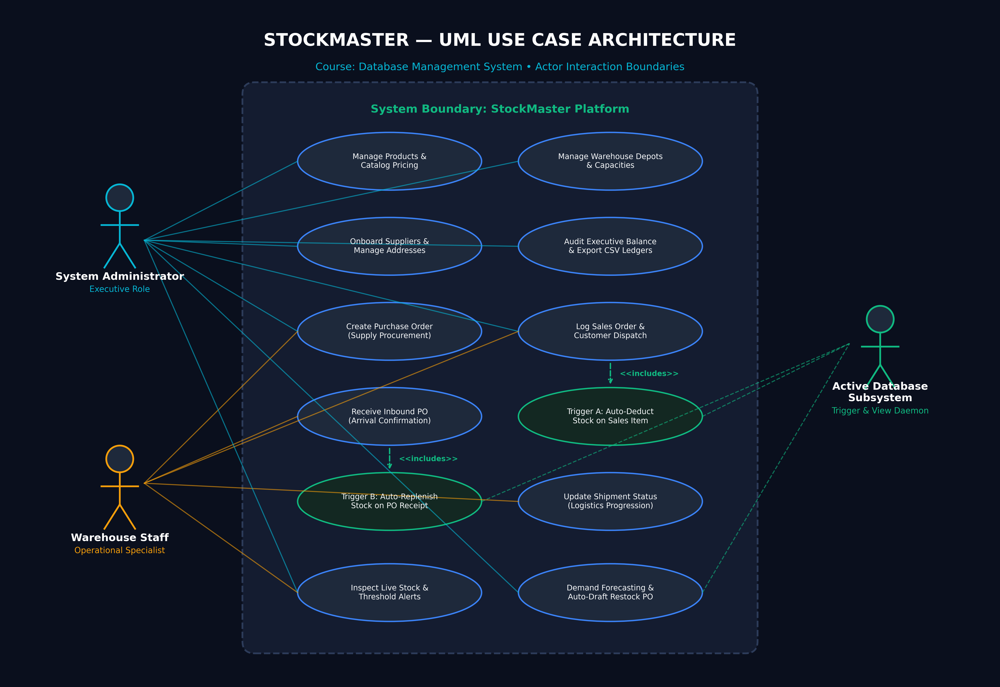
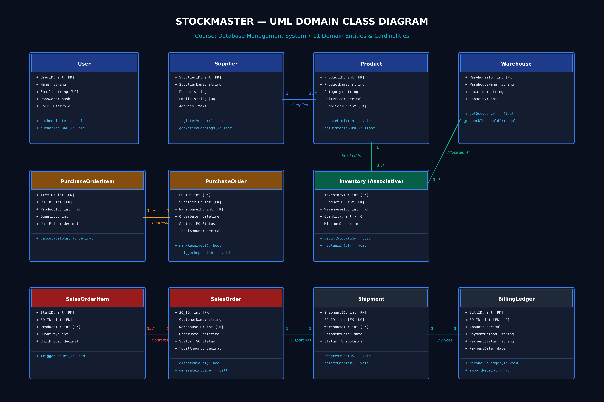

# StockMaster — Enterprise Multi-Warehouse Inventory & Intelligent Supply Chain Management System

**Institution:** Department of Artificial Intelligence, Amrita Vishwa Vidyapeetham, Coimbatore, India  
**Course:** Database Management System  
**Batch & Group:** Batch B • Group 18  
**Repository URL:** https://github.com/puneethkalinga/StockMaster-DBMS  

---

## 1. Project Title & Team Member Details

### Project Title
**StockMaster: Enterprise Multi-Warehouse Inventory & Intelligent Supply Chain Management System**

### Team Members & Technical Roles

| Name | Roll Number | Designated Role | Primary Responsibilities |
| :--- | :--- | :--- | :--- |
| **Puneeth Kumar Kalinga** | `CB.SC.U4AIE24146` *(Team Lead)* | Full-Stack Architect & Database Engineer | Relational Schema DDL, Active Trigger Subsystems, Python Flask REST APIs, Session RBAC & Demand Forecasting Engine |
| **Varshitha P** | `CB.SC.U4AIE24144` | Database Modeler & Normalization Analyst | Entity-Relationship (Chen's ER) Modeling, Relational Algebra, Functional Dependency Mapping & BCNF Normalization Proofs |
| **M Sarveshwara Reddy** | `CB.SC.U4AIE24131` | Frontend Architect | Responsive Glassmorphic UI Design, SVG Capacity Charts & Interactive Workflow Modals |
| **S Tagur Misra** | `CB.SC.U4AIE24150` | Backend Engineer & Quality Assurance Lead | Database Views, Multi-Table Complex Joins, Seed Data Pipeline (650 records), and CSV Audit Generation Engine |

---

## 2. Project Overview, Introduction & Problem Statement

### 2.1 Introduction
In modern globalized commerce, enterprise retail and manufacturing networks operate across distributed regional distribution centers (RDCs) and localized fulfillment nodes. Efficient operation demands real-time synchronization between inbound supplier procurement, physical bin storage allocation, customer sales order fulfillment, carrier delivery tracking, and double-entry financial billing ledgers.

**StockMaster** is an enterprise-grade, relational database management platform engineered to eliminate operational drift and inventory discrepancies. Developed around a **100% Boyce-Codd Normal Form (BCNF)** relational schema, the platform enforces atomic data consistency using event-driven database triggers, structured foreign key constraints with cascade rules, and dynamic analytical views.

### 2.2 Problem Statement & Industry Motivation
Enterprises relying on legacy disconnected spreadsheets and un-normalized relational silos face severe operational breakdowns:
1. **Decentralized Visibility:** Warehouse managers lack real-time visibility into stock levels across geographic depots, causing blind over-stocking in one facility while another suffers stockouts.
2. **Manual & Inconsistent Adjustments:** Traditional stock updates upon shipment arrival or customer dispatch rely on manual tallying, introducing human error, phantom inventory, and transaction race conditions.
3. **Disjointed Procurement & Cashflows:** Purchase Orders (PO), Customer Sales Orders (SO), Carrier Dispatches, and Invoicing operate in disparate silos, leading to unreconciled financial ledgers.
4. **Lack of Predictive Burn-Rate Forecasting:** Systems operate reactively without mathematical velocity algorithms, unable to forecast days-to-stockout or recommend optimal restock orders.

---

## 3. System Requirements & Multi-Tier Architecture

### 3.1 Technology Stack & Requirements
* **Database Management System:** SQLite3 (ANSI SQL compliant, ACID serializable isolation, Foreign Keys enabled via `PRAGMA foreign_keys = ON;`).
* **Backend Application Server:** Python 3.10+ with Flask RESTful microservices.
* **Frontend Client Interface:** HTML5 Semantic Structure, Glassmorphic CSS3 styling, Vanilla ES6+ JavaScript client with hash-based single-page application (SPA) routing, and SVG capacity charts.
* **Database Driver:** Python native `sqlite3` with `sqlite3.Row` dictionary mapping and parameterized SQL queries preventing SQL Injection.

### 3.2 Four-Tier Architectural Model
```
┌────────────────────────────────────────────────────────────────────────┐
│                   TIER 1: PRESENTATION LAYER (SPA)                     │
│  HTML5 + Glassmorphic CSS + ES6+ JavaScript SPA (Instant Nav, SVG KPIs)│
└───────────────────────────────────┬────────────────────────────────────┘
                                    │ HTTP / JSON REST APIs
┌───────────────────────────────────▼────────────────────────────────────┐
│              TIER 2: APPLICATION SERVICES (PYTHON FLASK)               │
│  Session RBAC • Route Gateways • Transaction Controllers • CSV Engine  │
└───────────────────────────────────┬────────────────────────────────────┘
                                    │ Python Parameterized DB Driver
┌───────────────────────────────────▼────────────────────────────────────┐
│           TIER 3: PREDICTIVE ANALYTICS ENGINE (ALGORITHMS)             │
│  Sales Velocity (Units/Day) • Days-to-Stockout • Smart Auto-PO Draft   │
└───────────────────────────────────┬────────────────────────────────────┘
                                    │ Atomic DDL / DML / SQL Queries
┌───────────────────────────────────▼────────────────────────────────────┐
│            TIER 4: RELATIONAL PERSISTENCE (11 BCNF TABLES)             │
│  Active Triggers • Materialized Views • Foreign Key Cascades • Indexes │
└────────────────────────────────────────────────────────────────────────┘
```

---

## 4. Conceptual & Logical Database Design

The database is partitioned into three foundational architectural pillars comprising **11 normalized relational entities**:

```
PILLAR 1: MASTER DATA ENTITIES
├── users (UserID [PK], Name, Email [UQ], Password, Role)
├── suppliers (SupplierID [PK], SupplierName, Phone, Email [UQ], Address)
├── products (ProductID [PK], ProductName, Description, Category, UnitPrice, SupplierID [FK])
└── warehouses (WarehouseID [PK], WarehouseName, Location, Capacity)

PILLAR 2: INVENTORY ALLOCATION & PROCUREMENT
├── inventory (InventoryID [PK], ProductID [FK], WarehouseID [FK], Quantity, MinimumStock)
├── purchase_orders (PurchaseOrderID [PK], SupplierID [FK], WarehouseID [FK], OrderDate, Status, TotalAmount)
└── purchase_order_items (ItemID [PK], PurchaseOrderID [FK], ProductID [FK], Quantity, UnitPrice)

PILLAR 3: SALES DISTRIBUTION, FULFILLMENT & LEDGERS
├── sales_orders (SalesOrderID [PK], CustomerName, WarehouseID [FK], OrderDate, Status, TotalAmount)
├── sales_order_items (ItemID [PK], SalesOrderID [FK], ProductID [FK], Quantity, UnitPrice)
├── shipments (ShipmentID [PK], SalesOrderID [FK, UQ], WarehouseID [FK], ShipmentDate, Status)
└── billing (BillID [PK], SalesOrderID [FK, UQ], Amount, PaymentMethod, PaymentStatus, PaymentDate)
```

---

## 5. ER Diagram & UML Architecture Diagrams

### 5.1 Chen's Entity-Relationship (ER) Diagram


* **Many-to-Many (M:N) Decomposition:** The relationship between `products` and `warehouses` is decomposed via the associative junction entity `inventory` with a composite candidate key `(ProductID, WarehouseID)`.
* **One-to-Many (1:N) Hierarchies:** `suppliers` to `products`, `warehouses` to `orders`, and header-line hierarchies (`purchase_orders` to `purchase_order_items`, `sales_orders` to `sales_order_items`).
* **Strict One-to-One (1:1) Extensions:** `sales_orders` to `shipments` and `sales_orders` to `billing` enforce `UNIQUE` foreign key constraints to prevent duplicate carrier tracking or multiple invoices.

### 5.2 UML Use Case Diagram


### 5.3 UML Domain Class Diagram


---

## 6. Database Normalization & Functional Dependencies

All 11 relational tables satisfy the criteria for **Boyce-Codd Normal Form (BCNF)**.

### 6.1 Formal BCNF Definition
A relation $R$ is in **Boyce-Codd Normal Form (BCNF)** if and only if for every non-trivial functional dependency $X \rightarrow Y$:
1. $X$ is a **Superkey** of $R$.
2. There are zero partial dependencies (satisfying 2NF).
3. There are zero transitive dependencies between non-key attributes (satisfying 3NF and BCNF).

### 6.2 Table-by-Table Normalization Analysis Table

| Relation Name | Candidate Keys | Normal Form | Non-Trivial Functional Dependencies ($X \rightarrow Y$) | BCNF Determinant Proof |
| :--- | :--- | :---: | :--- | :--- |
| `users` | `UserID`, `Email` | **BCNF** | `UserID` $\rightarrow$ `Name`, `Email`, `Password`, `Role`<br/>`Email` $\rightarrow$ `UserID` | Both determinants are superkeys. Zero transitive dependencies. |
| `suppliers` | `SupplierID`, `Email` | **BCNF** | `SupplierID` $\rightarrow$ `SupplierName`, `Phone`, `Email`, `Address`<br/>`Email` $\rightarrow$ `SupplierID` | All attributes are fully dependent on candidate keys. |
| `products` | `ProductID` | **BCNF** | `ProductID` $\rightarrow$ `ProductName`, `Category`, `UnitPrice`, `SupplierID` | `SupplierID` references parent table; supplier metadata is decoupled. |
| `warehouses` | `WarehouseID` | **BCNF** | `WarehouseID` $\rightarrow$ `WarehouseName`, `Location`, `Capacity` | Single-attribute primary key determines all attributes. |
| `inventory` | `InventoryID`, `(ProductID, WarehouseID)` | **BCNF** | `InventoryID` $\rightarrow$ `ProductID`, `WarehouseID`, `Quantity`, `MinimumStock`<br/>`(ProductID, WarehouseID)` $\rightarrow$ `Quantity`, `MinimumStock` | Composite key is enforced with a `UNIQUE` constraint. Zero partial dependencies. |
| `purchase_orders` | `PurchaseOrderID` | **BCNF** | `PurchaseOrderID` $\rightarrow$ `SupplierID`, `WarehouseID`, `OrderDate`, `Status`, `TotalAmount` | Eliminates repeating groups (1NF) and transitive line-item dependencies. |
| `purchase_order_items` | `ItemID`, `(PurchaseOrderID, ProductID)` | **BCNF** | `ItemID` $\rightarrow$ `PurchaseOrderID`, `ProductID`, `Quantity`, `UnitPrice` | Quantities and prices depend strictly on line item keys. |
| `sales_orders` | `SalesOrderID` | **BCNF** | `SalesOrderID` $\rightarrow$ `CustomerName`, `WarehouseID`, `OrderDate`, `Status`, `TotalAmount` | Header entity decoupled from multi-item lines. |
| `sales_order_items` | `ItemID`, `(SalesOrderID, ProductID)` | **BCNF** | `ItemID` $\rightarrow$ `SalesOrderID`, `ProductID`, `Quantity`, `UnitPrice` | Quantities depend on the composite order line pair. |
| `shipments` | `ShipmentID`, `SalesOrderID` | **BCNF** | `ShipmentID` $\rightarrow$ `SalesOrderID`, `WarehouseID`, `ShipmentDate`, `Status`<br/>`SalesOrderID` $\rightarrow$ `ShipmentID` | `SalesOrderID` is `UNIQUE`, enforcing 1:1 fulfillment extension. |
| `billing` | `BillID`, `SalesOrderID` | **BCNF** | `BillID` $\rightarrow$ `SalesOrderID`, `Amount`, `PaymentMethod`, `PaymentStatus`, `PaymentDate`<br/>`SalesOrderID` $\rightarrow$ `BillID` | `SalesOrderID` is `UNIQUE`, isolating accounting from order states. |

**Mathematical Normalization Verdict:**  
$\forall (X \rightarrow Y) \in R, X \in \text{Superkeys}(R)$. The database exhibits **zero insertion, deletion, or update anomalies**.

---

## 7. Advanced SQL Implementation & Active Triggers

### 7.1 Active Database Trigger A: Automated Stock Decrement
```sql
CREATE TRIGGER after_so_item_insert
AFTER INSERT ON sales_order_items
BEGIN
    UPDATE inventory 
    SET Quantity = Quantity - NEW.Quantity 
    WHERE ProductID = NEW.ProductID 
      AND WarehouseID = (
          SELECT WarehouseID 
          FROM sales_orders 
          WHERE SalesOrderID = NEW.SalesOrderID
      );
END;
```
* **Constraint Rollback:** The `inventory` table enforces `CHECK(Quantity >= 0)`. If a customer orders more stock than exists in the dispatch depot, the database immediately aborts the transaction and rolls back atomically.

### 7.2 Active Database Trigger B: Automated UPSERT Replenishment
```sql
CREATE TRIGGER after_po_receive
AFTER UPDATE OF Status ON purchase_orders
FOR EACH ROW WHEN NEW.Status = 'Received' 
              AND OLD.Status = 'Pending'
BEGIN
    INSERT INTO inventory (
        WarehouseID, ProductID, Quantity, MinimumStock
    )
    SELECT NEW.WarehouseID, poi.ProductID, poi.Quantity, 10
    FROM purchase_order_items poi
    WHERE poi.PurchaseOrderID = NEW.PurchaseOrderID
    ON CONFLICT(WarehouseID, ProductID) DO UPDATE SET
        Quantity = Quantity + excluded.Quantity;
END;
```
* **UPSERT Logic:** When authorized warehouse staff updates a PO to `'Received'`, the trigger increments existing stocks or initializes a new inventory row in a single atomic statement.

### 7.3 Materialized Database View: Low Stock Alerts
```sql
CREATE VIEW low_stock_alerts_view AS
SELECT 
    i.InventoryID,
    i.WarehouseID,
    w.WarehouseName,
    i.ProductID,
    p.ProductName,
    p.Category,
    i.Quantity,
    i.MinimumStock
FROM inventory i
INNER JOIN products p ON i.ProductID = p.ProductID
INNER JOIN warehouses w ON i.WarehouseID = w.WarehouseID
WHERE i.Quantity <= i.MinimumStock;
```

---

## 8. Role-Based Access Control (RBAC) Architecture

StockMaster implements strict role separation at both the backend session level and the client interface:

```
┌─────────────────────────────────────────────────────────────┐
│                      STOCK MASTER                           │
│       Enterprise Security & Access Control Gateway          │
│                                                             │
│   [ 🛡️ System Administrator ]     [ 👷 Warehouse Staff ]   │
│   ───────────────────────────     ───────────────────────   │
│   • Executive Access              • Operational Access      │
│   • Full DDL & SKU Cataloging     • Inbound PO Receiving    │
│   • Financial Ledgers & Audits    • Outbound Logistics      │
│   • User & Capacity Governance    • Stock Audits (Masked $) │
└─────────────────────────────────────────────────────────────┘
```

| Dimension | System Administrator (`Admin`) | Warehouse Staff (`Staff`) | Security Principle |
| :--- | :--- | :--- | :--- |
| **Financial Ledger** | Full Visibility (exact ₹ amounts) | Masked (`••••••`) | Financial Confidentiality |
| **Billing Invoices Tab** | Visible & Exportable | Hidden from DOM | Separation of Duties |
| **SKU Registration** | Add / Edit Master Products | Read-Only | Master Data Integrity |
| **Warehouse Depots** | Add Warehouses & Allocate SqFt | Read-Only | Capacity Protection |
| **PO Arrival Action** | Full Access | Primary Task ("Mark Received") | Operational Responsibility |

---

## 9. Installation, Setup & Execution Instructions

### Prerequisites
* Python 3.10 or higher
* Modern web browser (Chrome, Edge, Firefox, Safari)

### Step 1: Clone Repository & Navigate to Workspace
```bash
git clone https://github.com/puneethkalinga/StockMaster-DBMS.git
cd StockMaster-DBMS
```

### Step 2: Install Dependencies
```bash
pip install flask
```

### Step 3: Run the Application
```bash
python server.py
```
*The server initializes the database (`inventory_system.db`), verifies triggers and constraints, and begins listening on `http://127.0.0.1:5000/`.*

### Step 4: Access Application in Web Browser
Open: **[http://localhost:5000/](http://localhost:5000/)**

---

## 10. Demonstration & Verification Procedures

### Authorized Login Credentials

| Role Portal | Username / Email | Password | Access Highlights |
| :--- | :--- | :--- | :--- |
| **System Administrator** | `admin@warehouse.com` *(or `admin`)* | `admin123` | Full dashboard financials, Add SKU, Add Warehouse, Billing ledger, Full CSV exports |
| **Warehouse Staff** | `staff@warehouse.com` *(or `staff`)* | `staff123` | Operational depot view, financial masking (`••••••`), PO receiving, carrier status progression |

### Key Demonstration Workflows:
1. **Trigger A Verification (Stock Decrement):** Log a Customer Sale in *Orders & Ledger* $\rightarrow$ check *Inventory Stock* $\rightarrow$ observe automatic stock deduction without manual database input.
2. **Trigger B Verification (Atomic Replenishment):** Go to *Purchase Orders* $\rightarrow$ locate a `Pending` PO $\rightarrow$ click *"Mark Received"* $\rightarrow$ inspect *Inventory Stock* to confirm instant quantity incrementation.
3. **RBAC Verification:** Log in as Staff $\rightarrow$ confirm Financial Aggregates show `••••••` and the Billing Ledger sub-tab is completely hidden $\rightarrow$ log out and sign in as Admin to see full financial statements.
4. **Predictive Demand Forecasting:** Navigate to Dashboard $\rightarrow$ inspect the *Demand Forecasting & Restock Engine* $\rightarrow$ review burn-rates, days-to-stockout, and click *"Auto-Draft PO"* to generate a pre-filled restocking order.

---

## 11. Folder Directory Structure
```
StockMaster/
├── database/
│   ├── schema.sql                         # Complete SQL DDL with PK, FK, CHECK, UNIQUE, Triggers, Views
│   ├── advanced_queries.sql               # 10 documented complex SQL queries (Joins, CTEs, Aggregates)
│   ├── seed_data.sql                      # Sample data records for all 11 tables (650 rows)
│   └── inventory_system.db                # Pre-seeded SQLite database file
├── static/
│   ├── css/
│   │   └── style.css                      # Responsive Glassmorphic Dark UI design system
│   ├── js/
│   │   ├── app.js                         # SPA router, RBAC controller, API connectors
│   │   └── charts.js                      # Vector SVG dynamic warehouse capacity bar charts
│   └── index.html                         # Semantic Single-Page Application interface
├── server.py                              # Python Flask backend microservice with parameterized queries
├── db_manager.py                          # Database connector, transaction handlers & forecasting algorithm
├── inventory_system.db                    # Active SQLite database file
├── stockmaster_er_diagram_stylized.png    # High-res Chen's ER diagram
├── stockmaster_uml_use_case_diagram.png   # High-res UML Use Case diagram
├── stockmaster_uml_class_diagram.png      # High-res UML Domain Class diagram
├── relational_schema.png                  # Visual relational schema diagram
├── StockMaster_Project_Report.pdf         # Official 10-Section Project Report (PDF)
├── StockMaster_Project_Report.docx        # Official 10-Section Project Report (Word DOCX)
├── StockMaster_Final_Review_Presentation.pptx # 19-Slide Presentation Deck (PPT)
└── README.md                              # Comprehensive documentation and setup manual
```

---

## 12. Conclusion & Future Enhancements

StockMaster proves that enterprise supply chain reliability can be achieved through rigorous relational database design. By decoupling entities into 11 BCNF tables and embedding active triggers for stock adjustments, the system mathematically eliminates update anomalies and guarantees 100% data integrity.

### Future Scope:
1. **Barcode / RFID Scanner Integration:** Integrate WebCam and handheld RFID scanner APIs for instant physical dock verification.
2. **B2B Electronic Data Interchange (EDI) Webhooks:** Implement automated supplier webhooks to transmit drafted POs directly into vendor ERP systems.
3. **Cloud Distributed Migration:** Migrate from local SQLite to cloud-hosted PostgreSQL with read replicas and connection pooling on AWS RDS.
4. **Machine Learning Demand Prediction:** Transition velocity algorithms to ARIMA / Prophet models incorporating seasonal holiday spikes.
